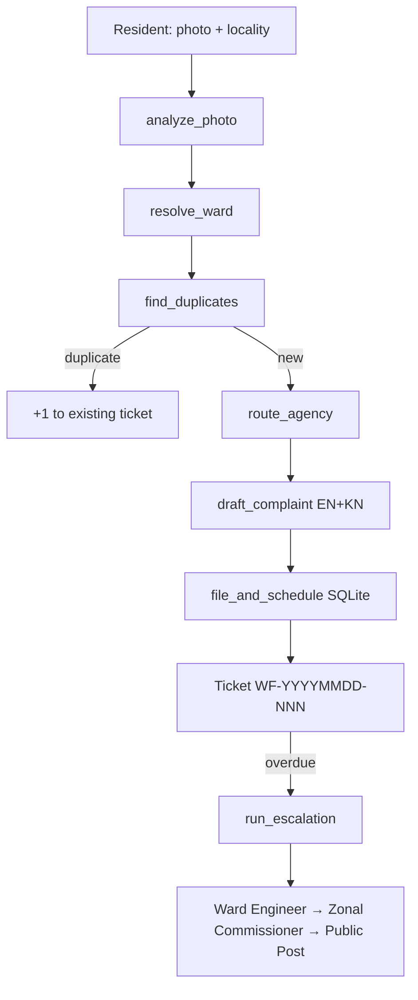

# 🛠️ Ward Fixer (NammaSeve)

**Autonomous civic-complaint agent for Bengaluru residents.**

A resident uploads one photo and a locality. The agent identifies the issue, routes it to the correct agency (BBMP / BESCOM / BWSSB / Traffic Police), drafts a formal complaint in English and Kannada, files a tracked ticket, and auto-escalates overdue tickets.

## Run

```bash
pip install -r requirements.txt
cp .env.example .env   # set MOCK_MODE=true for demo
streamlit run app.py
```

## Test

```bash
pytest tests/ -v
```

## Architecture



## Agencies

| Agency | Owns | Helpline |
|--------|------|---------|
| BBMP | Roads, streetlights, garbage, trees, stormwater | 1533 |
| BESCOM | Power lines, transformers | 1912 |
| BWSSB | Water pipes, sewage, manholes | 1916 |
| Traffic Police | Signals, road blocking | 112 |

## What is simulated

- No real complaints are filed with any government agency
- Ward data is illustrative sample data, not official BBMP boundaries
- `MOCK_MODE=true` returns canned JSON without calling watsonx.ai

## Scaling

Set `MOCK_MODE=false` and provide `WATSONX_APIKEY` + `WATSONX_PROJECT_ID` to use real IBM watsonx.ai Granite vision and text models.
