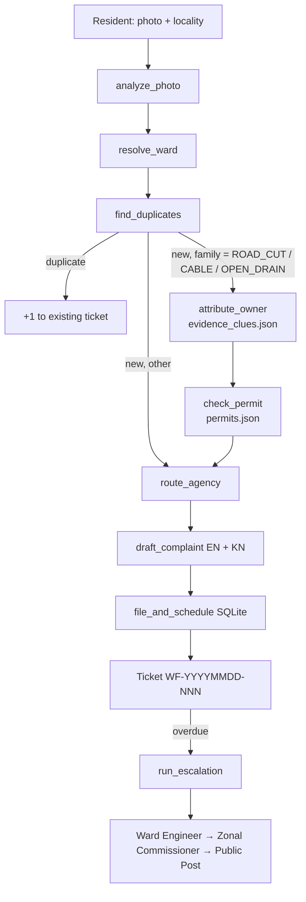

# NammaSeve

**Find who owns a civic hazard in Bengaluru, and send them a complaint that sticks.**

NammaSeve drafts and routes complaints. You send them.

## Problem

A trench cut across the road and never restored. A cable hanging at head height. An open drain with no cover. Residents see these every day and don't know who to complain to. The road belongs to the city corporation, but the trench may be BWSSB's, BESCOM's or a telecom operator's. A hanging cable might be live power or harmless fibre. An open drain might be a BWSSB sewer or a corporation storm drain. Complaints bounce between agencies and the hazard stays.

## Solution

A resident describes the hazard (answering two quick questions, or with an optional photo that the vision model uses to pre-fill those answers when watsonx credentials are set) and picks a locality. The agent:

1. Classifies the hazard into a family: **ROAD_CUT**, **CABLE** or **OPEN_DRAIN**. Anything else takes a short single-owner path.
2. Builds an **Evidence board**: visible clues (pipe colour, duct type, barricade stencils, manhole shape, sewage vs rainwater), ranked suspects with confidence, a verdict and the basis for it.
3. For road cuts, the notice asks the city corporation to confirm whether a road-cutting permit was issued and its restoration due date.
4. Routes to the owner with a one-line reason:
   - **CABLE**: live power goes to BESCOM (severity 5, safety banner); telecom fibre goes to the corporation's OFC cell; streetlight cable goes to the corporation's electrical division. If the cable type is unsure, the agent assumes live power.
   - **OPEN_DRAIN**: a sewer goes to BWSSB; a storm drain goes to the city corporation; if both apply, BWSSB is primary and the corporation is copied.
5. Drafts a complaint in English and Kannada and shows a **Ready to send** card with the agency's published email, helpline and WhatsApp number, an "Open in email app" button and a Copy button. The resident sends it and marks it "I have sent it".
6. Adds **+1** to an existing open ticket instead of filing a duplicate.
7. Drafts a **follow-up** email for complaints the resident has sent, quoting the original NammaSeve reference and date. In the demo, use "Draft follow-up (demo: skip 7 days)".

Wards map to the five city corporations under the Greater Bengaluru Authority: Bengaluru Central, East, West, North and South City Corporation.

## Architecture



| Path | What it is |
|------|------|
| `app.py` | Streamlit UI with two tabs, a live trace, the Evidence board, agency badge and dual notices |
| `agent/tools.py` | The eight pipeline steps plus the `run_agent` orchestrator |
| `agent/llm.py` | The only place models are called (`vision_json`, `text_json`): IBM watsonx.ai, or mock |
| `agent/escalation.py` | Escalation agent |
| `db/database.py` | SQLite ticket store |
| `data/wards.json` | Localities, wards and GBA corporations |
| `data/evidence_clues.json` | Clue → suspect weights used for attribution |
| `data/permits.json` | Sample road-cutting permits |
| `data/routing_rules.json` | Single-owner routing rules |
| `samples/` | Demo photos; their filenames drive mock mode |

## Run

```bash
python3 -m venv .venv && source .venv/bin/activate
pip install -r requirements.txt
cp .env.example .env   # MOCK_MODE=true for the demo
streamlit run app.py
```

Demo files in `samples/`: `roadcut_overdue.jpg`, `roadcut_nopermit.jpg`, `livewire.jpg`, `telecom.jpg`, `sewer.jpg`, `stormdrain.jpg`. In mock mode the canned result is picked by a keyword in the filename. Typing the keyword in the description also works.

## Test

```bash
pytest tests/ -v
```

There is one test per use case: overdue permit, no permit, watching, each cable type including the unsure case, sewer, storm drain, both, the single-owner path, duplicate +1, escalation and the GBA ward mapping.

## Agencies

| Agency | Owns | Helpline |
|--------|------|---------|
| City Corporation (GBA) | Roads, storm drains, streetlights, OFC permissions | 1533 |
| BESCOM | Power lines, transformers | 1912 |
| BWSSB | Water pipes, sewers, sanitary manholes | 1916 |
| Traffic Police | Signals, road blocking | 112 |

## What is simulated

- NammaSeve never sends anything. The resident sends the complaint from their own email app. NammaSeve references are local only.
- Ward, permit and clue data are illustrative sample data, not official records.
- "Draft follow-up (demo: skip 7 days)" moves the clock forward for the demo. No real time passes.
- `MOCK_MODE=true` returns canned JSON without calling watsonx.ai.

## Scaling

Set `MOCK_MODE=false` and provide `WATSONX_APIKEY` and `WATSONX_PROJECT_ID` to use real IBM watsonx.ai models. Any model error falls back to the mock result. The trace marks this with `_fallback`.
